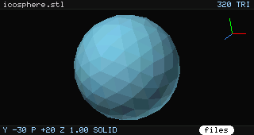
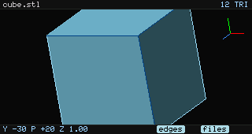
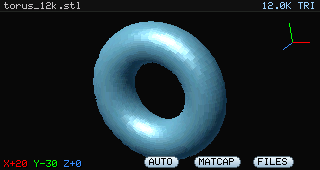
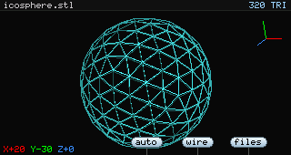
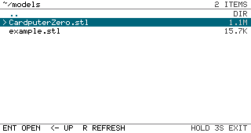
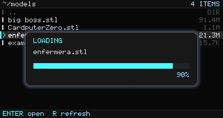
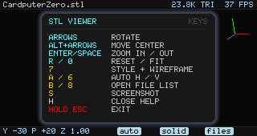
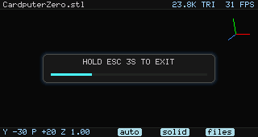

# KanSTL

[](https://www.gnu.org/licenses/gpl-3.0)
[]()

A small STL 3D viewer for the M5Stack Cardputer Zero (320x170 RGB565
framebuffer). It loads binary or ASCII STL files and renders them with a
software rasterizer, straight into `/dev/fb0`.

**Status: M4 in progress** - STL loading, solid/edges/matcap rendering,
wireframe toggle, rotate/zoom, and an in-app file browser.



## Features

- In-app file browser: browse folders, open `.stl` files, remembers the last
  directory, shows file sizes and load errors
- Modal loading popup with filename, progress bar and percentage
- Esc-to-exit needs a deliberate 3 second hold, with an on-screen progress bar
- Binary and ASCII STL loading, model centered and fitted to the viewport
  automatically (use `--zoom` to override)
- Solid flat shading with a z-buffer and backface culling
- EDGES mode: solid faces with dark crease lines and a bright silhouette
- MATCAP mode: metallic normal-map shading with a specular highlight
- `7` cycles solid / edges / matcap / wireframe; the bottom pill shows the
  current style
- `6` cycles auto-rotate off / X pitch / Y yaw / Z model-axis roll (the Z
  axis is held horizontal); the tab turns mint green when active
- Wireframe mode included in the `7` render-style cycle
- Arrow keys rotate, `Alt` + arrows move the rotation center
- `Enter` / `Space` zoom, `R` / `0` reset the view and center
- Red/green/blue XYZ orientation gizmo in the top-right corner, drawn above
  the model and overlays
- `8` opens the file list; `Esc` is exit-only (hold 3 seconds)
- Pixel-art UI using a 6x8 bitmap font, no LVGL dependency
- Light-blue "files" pill in the bottom bar, aligned with the physical 8 key
- Offscreen PNG rendering for development without a device
- Built-in benchmark mode
- Runs as the normal `pi` user under APPLaunch

## Build

Native (for screenshots and benchmarks on a desktop):

```bash
cmake -S . -B build -DCMAKE_BUILD_TYPE=Release
cmake --build build -j$(nproc)
```

Cross-compile for the Cardputer Zero:

```bash
cmake -S . -B build-aarch64 -DCMAKE_BUILD_TYPE=Release \
  -DCMAKE_SYSTEM_NAME=Linux -DCMAKE_SYSTEM_PROCESSOR=aarch64 \
  -DCMAKE_CXX_COMPILER=aarch64-linux-gnu-g++
cmake --build build-aarch64 -j$(nproc)
```

## Usage

```bash
# Interactive file browser (default when no model is given)
./kanstl

# Open one model directly
./kanstl model.stl

# Print a directory listing without a framebuffer/keyboard
./kanstl --list ~/models

# Render one frame to a PNG (works on a desktop)
./kanstl --shot out.png examples/icosphere.stl
./kanstl --no-ui --shot clean.png examples/cube.stl

# Camera options
./kanstl --yaw 45 --pitch 30 --zoom 1.5 --shot out.png model.stl

# Start spinning automatically (useful for demos)
./kanstl --auto model.stl

# Render style and pure wireframe
./kanstl --style edges model.stl
./kanstl --style matcap --shot matcap.png examples/icosphere.stl
./kanstl --wireframe model.stl

# Benchmark the renderer (offscreen)
./kanstl --bench 300 examples/icosphere.stl
./kanstl --bench 300 --style edges examples/icosphere.stl
./kanstl --bench 300 --wireframe examples/icosphere.stl
```

With no model path the app starts in the file browser at the last used
directory, or `$HOME` on first start. `--auto` without a path opens the most
recently modified `.stl` from the usual locations.

On the desktop, `--shot`, `--bench` and `--list` need no framebuffer or
keyboard.

## Performance

Measured on a Cardputer Zero (CM0) at 320x170 with a 12,000 triangle torus:

```text
solid       7.8 ms/frame   ~128 fps   (12k triangles)
wireframe  12.6 ms/frame    ~79 fps   (12k triangles)
edges      17.8 ms/frame    ~56 fps   (23.8k triangles)
matcap     10.1 ms/frame    ~99 fps   (23.8k triangles)
```

The frame rate in the status bar is the rate frames actually reach the panel;
idle time is excluded.

## Render styles

`7` cycles solid → edges → matcap → wireframe, and the bottom pill shows the
active style.

EDGES:



MATCAP:



Wireframe:



## File browser



| Key | Action |
| --- | --- |
| Up / Down | Select |
| PgUp / PgDn | Page |
| `Enter` | Open folder / model |
| `Left` / `Backspace` | Parent folder |
| `R` | Refresh |
| `Esc` (hold 3s) | Exit, with an on-screen countdown |

`Esc` is exit-only in the file browser; use `Left` or `Backspace` to go up a
directory.

Only folders and `.stl` files are listed. The last directory and file selection
are remembered in `~/.config/kanstl/last_dir`.

Opening a model shows a modal progress popup:



## Viewer controls

| Key | Action |
| --- | --- |
| Arrows | Rotate |
| Alt + Arrows | Move the rotation center (model follows the arrow) |
| `Enter` | Zoom in |
| `Space` | Zoom out |
| `R` | Reset view and center |
| `0` | Fit the model to fill the viewport and recenter |
| `7` | Cycle solid / edges / matcap / wireframe |
| `6` | Cycle auto-rotate off / X / Y / Z |
| `8` | Open the file list |
| `S` | Save `/tmp/kanstl_shot.png` |
| `H` | Help overlay |
| `Esc` | Close help; hold 3s to exit |

The help overlay groups keys by color:



On the Cardputer Zero, `F` / `Z` / `X` / `C` are accepted as arrow keys as well.

Holding `Esc` for 3 seconds exits; a progress prompt appears while holding:



## Install on the device

From the repository root on the Cardputer Zero:

```bash
BUILD=build-aarch64 ./scripts/install-device.sh
```

This installs the binary, `.desktop` entry and icon under
`/usr/share/APPLaunch`.

## Examples

`examples/cube.stl` and `examples/icosphere.stl` are generated by
`tools/gen_test_stl.py`:

```bash
python3 tools/gen_test_stl.py --shape torus --segments 100 --rings 60 \
  --out torus_12k.stl
```

## Design notes

See [docs/DESIGN.md](docs/DESIGN.md) for the rendering pipeline, performance
budget and roadmap.

## License

GPL-3.0. The bitmap font and some platform patterns are shared with
[zeroSDR](https://github.com/nullbeing/zerosdr).
